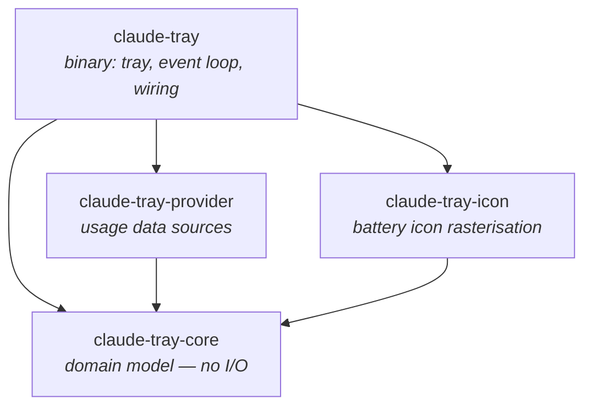
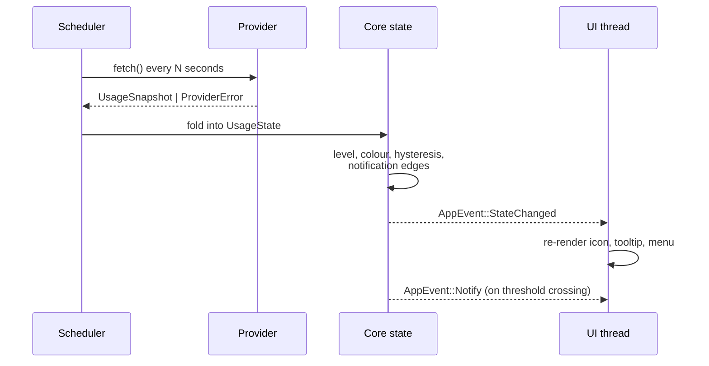

# Architecture

> **Status: draft.** This describes the intended design. Very little of it is built yet.
> It will be revised as implementation proves parts of it wrong.

## Overview

Claude Tray is a small, always-running desktop agent. It periodically asks a **provider**
for the current Claude usage, folds the answer into a **domain state**, and reflects that
state in a **tray icon**, a **tooltip**, and optional **notifications**.

The design is shaped by one dominant uncertainty: *where the usage data comes from is not
yet settled, and may change*. Everything therefore hangs off a provider trait, and the
entire user interface is developed against a mock.

## Crate graph



| Crate | Responsibility | May depend on |
| ----- | -------------- | ------------- |
| `claude-tray-core` | Usage types, percentage and colour logic, threshold and notification rules, tooltip text | Nothing with I/O |
| `claude-tray-provider` | `UsageProvider` trait, mock provider, real providers, HTTP client, retry and backoff | `core`, `reqwest`, `tokio` |
| `claude-tray-icon` | Turning a state into RGBA pixels; themes; caching | `core`, a rasteriser |
| `claude-tray` | Tray, menu, scheduler, config, auth, notifications, logging | all of the above |

### The one rule that matters

**`claude-tray-core` has no I/O dependencies.** No network, no filesystem, no clock
except what is injected, no display. This is what makes the majority of the project's
logic testable in CI on every platform without a desktop session, and it is enforced by
review and by a dependency check.

## Data flow



## Threading model

Two execution contexts, connected by a channel:

- **The UI thread** owns the tray handle and the platform event loop. On macOS and
  Windows the tray object *must* live on the main thread. This thread only paints and
  handles menu clicks — it never performs I/O and never blocks.
- **A Tokio runtime** on background threads owns the scheduler, providers, HTTP, and
  file access.

Background work communicates results to the UI thread by sending an `AppEvent` through
the event loop's user-event proxy. Nothing else crosses the boundary.

## State machine

```
Loading ──────► Ok ◄──────► Stale
   │            │             │
   │            ▼             ▼
   └──────► Error ◄─── NotAuthenticated
                │
                └──► (recovers to Ok on a successful fetch)
```

- `Loading` — before the first fetch resolves. The cached snapshot from disk is shown if
  one exists, so the icon is meaningful immediately at startup.
- `Ok` — a fresh snapshot.
- `Stale` — no successful fetch for `3 × interval`. The last good value is still shown,
  dimmed, rather than dropping to unknown.
- `Error` / `NotAuthenticated` — the icon shows a distinct state and the menu offers the
  corrective action.

Degradation is always toward *showing something honest*, never toward a popup.

## Key decisions

Recorded as ADRs in [`docs/adr/`](adr/):

| ADR | Decision |
| --- | -------- |
| [0001](adr/0001-rust-and-tray-icon.md) | Rust with the `tray-icon` crate for the tray layer |
| [0002](adr/0002-provider-abstraction.md) | A provider trait abstracts all usage data sources |

## Design constraints

Carried from the project goals; these are the tie-breakers:

| Constraint | Target |
| ---------- | ------ |
| Idle memory | < 15 MB RSS |
| Idle CPU | < 0.1% |
| Cold start to visible icon | < 300 ms |
| Telemetry | None, ever |
| Quota consumed by the app | Zero — read-only |

## Open questions

1. **Which provider is the default?** Blocked on the data-source research; the outcome is
   recorded in `docs/DATA-SOURCES.md` and ADR-0003.
2. **Does any available source expose a real quota limit**, or only consumption? Without a
   limit, "percentage remaining" cannot be computed honestly and the UI would need to show
   absolute usage instead.
3. **Icon pipeline**: pre-baked rasters or runtime SVG rendering. Leaning runtime for
   theme flexibility and binary size.
4. **History storage**: append-only JSONL is the starting point; SQLite only if the
   queries justify it.
